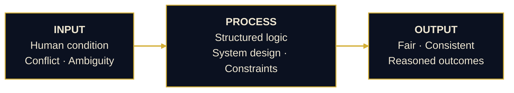

<picture>
  <source media="(prefers-color-scheme: dark)" srcset="./src/images/banner-dark.svg">
  <source media="(prefers-color-scheme: light)" srcset="./src/images/banner-light.svg">
  
</picture>

 

<picture></picture>
<picture></picture>
<picture></picture>

<picture></picture>

## § I — Position

> Law without reason becomes authority.  
> Systems without justice become control.

**RatioJuris** operates where both are held accountable: through structure, logic, and deliberate design.

<picture></picture>

## § II — Doctrine

| Maxim | Meaning |
| :--- | :--- |
| *Ratio fundamentum legis est* | Reason is the foundation of law. |
| *Systemata exitus determinant* | Systems determine outcomes. |
| *Justitia non dicitur — construitur* | Justice is not merely declared; it is constructed. |

📜 **Read the full doctrine →** [*The Doctrine of Judicial Justice and Absolute Justice*](https://github.com/RatioJuris/The-Doctrine-of-Judicial-Justice-and-Absolute-Justice)

<picture></picture>

## § III — Architecture

<picture></picture>

## § IV — Domains

<picture></picture>
<picture></picture>
<picture></picture>
<picture></picture>
 
<picture></picture>
<picture></picture>
<picture></picture>
<picture></picture>

<picture></picture>

## § V — Instruments

<picture>
  <source media="(prefers-color-scheme: dark)" srcset="https://skillicons.dev/icons?i=java,cs,py,ts,js,php,cpp,kotlin,html,css,powershell,bash&theme=dark">
  
</picture>
 
<picture>
  <source media="(prefers-color-scheme: dark)" srcset="https://skillicons.dev/icons?i=react,nodejs,cloudflare,wordpress,linux,windows,git,github,vscode&theme=dark">
  
</picture>

<picture></picture>

## § VI — Selected Works

<table>
<tr>
<td width="50%" valign="top">

**⚖️ [The Doctrine of Judicial & Absolute Justice](https://github.com/RatioJuris/The-Doctrine-of-Judicial-Justice-and-Absolute-Justice)**  
A doctrine defining absolute justice and its relationship with judicial justice.

<picture></picture>

</td>
<td width="50%" valign="top">

**📜 [OSJ Doctrine](https://github.com/RatioJuris/osj-doctrine)**  
A statute-form manifesto arguing for citation-backed *proof-of-execution* over credentials and paid certificates.

<picture></picture>

</td>
</tr>
<tr>
<td valign="top">

**✒️ [PDF DSC-TSA Bulk Signer](https://github.com/RatioJuris/BulkFieldSignerGUI)**  
Stamps a visible signature on selected pages and digitally secures the whole PDF in one step.

<picture></picture>

</td>
<td valign="top">

**🔏 [Bhartiya Sakshya Adhiniyam Hash](https://github.com/RatioJuris/Bhartiya-Sakshya-Adhiniyam-Hash-Online)**  
Generates and compares SHA-256 / SHA-1 / MD5 evidence hashes, with signed PDF reports.

<picture></picture>

</td>
</tr>
<tr>
<td valign="top">

**🖨️ [FS Legal-Size Scanner](https://github.com/RatioJuris/FS-Legal-Size-Scanner)**  
Lets ordinary A4 flatbed scanners produce Foolscap / legal-size scans.

<picture></picture>

</td>
<td valign="top">

**📐 [AB Layout](https://github.com/RatioJuris/ab-layout)**  
Advocate Benefit Layout for legal document formatting.

<picture></picture>

</td>
</tr>
<tr>
<td valign="top">

**🛡️ [Security Research](https://github.com/RatioJuris/security-research)**  
Investigations into web security, digital forensics, and infrastructure vulnerabilities.

<picture></picture>

</td>
<td valign="top">

**🌼 [Photos](https://github.com/RatioJuris/photos)**  
A calm, iOS-style Android gallery where locked photos still look like ordinary pictures to everyone else. No account, no cloud, no tracking.

<picture></picture> <picture></picture>

</td>
</tr>
<tr>
<td colspan="2" valign="top">

**📚 [RefIndia](https://github.com/RatioJuris/RefIndia)**: citations for Indian law and academia  
Cite Supreme Court judgments, Acts, books, articles and theses in ILI, OSCOLA, APA, Harvard, MLA, IEEE and Chicago. Real DOI and ISBN lookup, BibTeX/RIS conversion, and an Indian legal formatter for SCC, AIR and INSC citations. Runs entirely in the browser.

 <picture></picture> <picture></picture>

</td>
</tr>
</table>

<picture></picture>

## § VII — Opus Quotidianum

*Daily work: consumed, and continued.*

<picture>
  <source media="(prefers-color-scheme: dark)" srcset="./src/cards/snake-dark.svg">
  
</picture>

<picture></picture>

## § VIII — Signal

This is not a portfolio. It is a **framework under construction**.

A scholar of law never ceases to be a student: law is a lifelong discipline, continuously re-learned.  
The same holds for computer science.  
Neither field permits arrival, only ongoing study.

<picture></picture>

> **Reason before rule.** · **Structure before scale.** · **Justice through systems.** · **Law through logic.**

 

<picture>
  <source media="(prefers-color-scheme: dark)" srcset="./src/images/signature-dark.svg">
  
</picture>

<b>RatioJuris</b> · Independent · Pseudonymous · System-Oriented

 

<b>⟡ Disclaimers</b>

 

> **Pseudonymous is not anonymous.**  
> RatioJuris operates under a consistent, identifiable pseudonymous presence, not an untraceable or unaccountable one.

> **© Copyright Notice**  
> All original content, doctrine, structure, and phrasing published here is protected by copyright. Reproduction, redistribution, or republication requires prior authorisation and must carry proper attribution to RatioJuris. This does not limit the rights GitHub's Terms of Service grant to view and fork public repositories.

